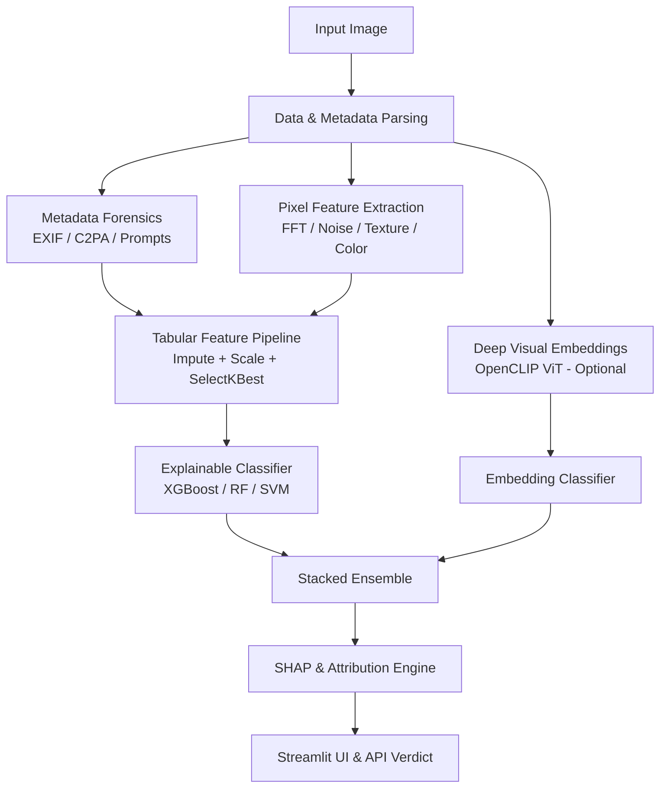

# 🛡️ AiDetect: Explainable AI-Generated Image Detector

[](https://www.python.org/)
[](https://streamlit.io/)
[](https://pytorch.org/)
[](https://xgboost.readthedocs.io/)
[](LICENSE)

An explainable computer-vision and forensics toolkit designed to classify images as **real camera photographs** or **AI-generated visuals**—and explain precisely *why*. 

By combining digital forensic metadata mining, handcrafted pixel statistics, and optional deep multimodal vision embeddings (OpenCLIP), **AiDetect** provides transparent and interpretable verdicts rather than opaque black-box scores.

---

## 📑 Table of Contents

- [Overview](#-overview)
- [Key Features](#-key-features)
- [System Architecture](#-system-architecture)
- [Directory Structure](#-directory-structure)
- [Getting Started](#-getting-started)
  - [Prerequisites](#prerequisites)
  - [Installation](#installation)
- [Dataset Preparation](#-dataset-preparation)
- [Training](#-training)
  - [Basic Training](#1-basic-training)
  - [Training with OpenCLIP Deep Features](#2-training-with-openclip-deep-features)
  - [Advanced Training CLI Arguments](#3-advanced-cli-arguments)
- [Running the Application](#-running-the-application)
  - [Streamlit Dashboard](#1-streamlit-dashboard)
  - [Python API Usage](#2-programmatic-python-api)
- [Forensic & Feature Methodology](#-forensic--feature-methodology)
- [Troubleshooting](#-troubleshooting)
- [License & Disclaimer](#-license--disclaimer)

---

## 🔍 Overview

Modern image generation models (Midjourney, Stable Diffusion, DALL-E, Flux, Ideogram) create photorealistic textures that deceive traditional heuristics. **AiDetect** bridges forensic inspection with machine learning by analyzing:

1. **Digital Provenance & Metadata**: Scans EXIF headers, camera make/model/lens information, software identifiers, embedded prompt text, and C2PA / IPTC provenance credentials.
2. **Structural & Statistical Pixel Cues**: Measures high-frequency FFT power, Laplacian sharpness variance, GLCM texture matrices, color channel entropy, and spatial noise consistency.
3. **Deep Multimodal Embeddings (Optional)**: Uses OpenCLIP (`ViT-B-16` / `ViT-L-14`) to capture semantic distribution shifts.
4. **Explainable Attribution**: Quantifies each feature's contribution via SHAP and linear feature attributions, delivering human-readable reasons behind every prediction.

---

## ✨ Key Features

- **Dual-Family Feature Extraction**:
  - `meta_*`: Forensic cues extracted directly from EXIF, PNG text chunks, and provenance tags.
  - `vis_*`: Invariant statistical, textural, and frequency features extracted from image pixels.
- **Explainable Predictions**: Explanations highlight specific factors (e.g., missing sensor noise, typical diffusion dimensions, metadata markers, or unnatural color uniformity).
- **Ensemble & Classifier Benchmarking**: Evaluates and compares Logistic Regression, Decision Trees, Random Forests, Support Vector Machines (SVM), and XGBoost.
- **Multimodal CLIP Stacking**: Optional stacked generalization combining tabular forensic features with deep vision transformer representations.
- **Interactive Web Interface**: Streamlit UI featuring verdict cards, probability gauges, feature breakdowns, and metadata inspections.

---

## 🏗️ System Architecture



---

## 📂 Directory Structure

```text
AiDetect/
├── app.py              # Interactive Streamlit dashboard UI
├── train.py            # Model training, cross-validation, and ROC/CM evaluation
├── predict.py          # Unified inference pipeline (image -> verdict & reasons)
├── explain.py          # SHAP attribution & human-readable explanation generator
├── features.py         # Forensic metadata & pixel-level feature mining
├── embed.py            # OpenCLIP feature extraction & multimodal utilities
├── data.py             # Dataset discovery, balancing, and parallel feature caching
├── requirements.txt    # Python dependencies
└── README.md           # Project documentation
```

---

## 🚀 Getting Started

### Prerequisites

- **Python 3.9+**
- Recommended: Dedicated virtual environment (`venv` or `conda`)
- Optional: CUDA-compatible GPU for accelerated OpenCLIP inference and training

### Installation

1. **Clone the repository**:
   ```bash
   git clone https://github.com/varghesejibu/AiDetect.git
   cd AiDetect
   ```

2. **Create and activate a virtual environment**:
   - **Linux / macOS**:
     ```bash
     python3 -m venv venv
     source venv/bin/activate
     ```
   - **Windows (PowerShell)**:
     ```powershell
     python -m venv venv
     .\venv\Scripts\Activate.ps1
     ```

3. **Install dependencies**:
   ```bash
   pip install --upgrade pip
   pip install -r requirements.txt
   ```

---

## 📊 Dataset Preparation

AiDetect can be trained on standard computer-vision datasets. A recommended dataset is [`malaxmels/ai-detection-dataset`](https://www.kaggle.com/datasets/malaxmels/ai-detection-dataset) on Kaggle.

1. **Download via Kaggle CLI**:
   ```bash
   kaggle datasets download -d malaxmels/ai-detection-dataset --unzip -p archive
   ```

2. **Expected Directory Layout**:
   You can organize data either with folder names containing keywords (`real` vs. `ai`), or in explicit subdirectories:
   ```text
   archive/dataset/
   ├── real/
   │   ├── photo_001.jpg
   │   └── photo_002.jpg
   └── ai/
       ├── generated_001.png
       └── generated_002.png
   ```

   *Alternatively, provide a CSV manifest with `--labels-csv path/to/labels.csv --path-col file_name --label-col label`.*

---

## 🏋️ Training

### 1. Basic Training

Train on handcrafted pixel features and metadata (fast, lightweight, highly explainable):

```bash
python train.py --data archive/dataset --max-per-class 3000
```

### 2. Training with OpenCLIP Deep Features

To boost classification accuracy on modern diffusion models, enable the deep visual ensemble:

```bash
python train.py --data archive/dataset --max-per-class 3000 --clip --clip-model ViT-B-16
```

### 3. Advanced CLI Arguments

| Argument | Type | Default | Description |
| :--- | :---: | :---: | :--- |
| `--data` | `str` | `None` | Path to dataset root (labels automatically inferred). |
| `--real`, `--ai` | `str` | `None` | Specific directories for real and AI classes. |
| `--labels-csv` | `str` | `None` | CSV file containing file paths and label mappings. |
| `--max-per-class` | `int` | `3000` | Maximum balanced samples per class to prevent skew. |
| `--k` | `int` | `25` | Number of top features retained by Mutual Information selection. |
| `--all-features` | `flag` | `False` | Includes dimensions and file formats (use cautiously to avoid dataset bias). |
| `--clip` | `flag` | `False` | Computes OpenCLIP embeddings and fits a stacked ensemble. |
| `--clip-model` | `str` | `ViT-B-16` | OpenCLIP backbone (`ViT-B-16`, `ViT-L-14`, etc.). |
| `--extra-real` | `list` | `[]` | Additional folders of real photos (e.g. personal camera images). |
| `--extra-ai` | `list` | `[]` | Additional folders of AI images from other generators. |
| `--out` | `str` | `models` | Output directory for saved artifacts (`model.joblib`, plots, metrics). |

> [!NOTE]
> Training artifacts will be saved into the `models/` directory, including confusion matrices (`confusion_matrix.png`), ROC evaluation curves (`roc_curve.png`), and cross-validation summaries (`cv_results.json`).

---

## 🖥️ Running the Application

### 1. Streamlit Dashboard

Launch the interactive web application:

```bash
streamlit run app.py
```

Once running, navigate to the local URL (typically **`http://localhost:8501`**) to upload and analyze images.

### 2. Programmatic Python API

You can also integrate **AiDetect** directly into Python scripts and pipelines:

```python
from predict import load_bundle, analyze

# 1. Load trained model bundle
bundle = load_bundle("models/model.joblib")

# 2. Analyze an image
result = analyze("path/to/test_image.jpg", bundle)

# 3. Inspect results
print(f"Verdict: {result['label']}")
print(f"Probability AI: {result['p_ai']:.2%}")
print(f"Confidence: {result['confidence']:.2%}")

print("\nKey Explanations:")
for r in result["reasons"]:
    print(f"- {r['text']}")
```

---

## 🔬 Forensic & Feature Methodology

AiDetect inspects images across two primary dimensions:

### 1. Metadata & Digital Provenance
- **Hardware Footprints**: Detection of camera make, model, lens profile, focal length, ISO, aperture, and capture timestamps.
- **Software Signatures**: Verification of software tags against known AI generators (e.g., Midjourney, DALL-E, Stable Diffusion, ComfyUI, Automatic1111).
- **Embedded Text Chunks**: Detection of parameters, workflows, and prompts embedded in PNG text blocks.
- **Standards-based Provenance**: Validation of C2PA and IPTC AI media assertion tags.

### 2. Pixel & Statistical Metrics
- **Frequency Domain (FFT)**: Fast Fourier Transform radial power spectrum analysis to uncover grid patterns and high-frequency decay typical of upsampling artifacts.
- **Noise Consistency**: Median Absolute Deviation (MAD) and standard deviation of high-pass residuals to measure physical sensor noise vs. synthetic smoothing.
- **Texture Matrices (GLCM)**: Gray-Level Co-occurrence Matrix energy, contrast, correlation, and homogeneity.
- **Structural Repetition (LBP)**: Local Binary Pattern entropy highlighting micro-texture repetition.
- **Color Dynamics**: Channel distribution, histogram entropy, saturation variance, and unique color diversity ratios.

---

## 🛠️ Troubleshooting

### `EmptyDataError` during Feature Extraction
If a previous run was interrupted and wrote a corrupt cache file:
- **Windows**:
  ```powershell
  Remove-Item models/features*.csv -ErrorAction Ignore
  ```
- **Linux / macOS**:
  ```bash
  rm -f models/features*.csv
  ```

### Missing XGBoost
If XGBoost fails to load or install on your platform, AiDetect will cleanly fall back to Random Forest, SVM, or Logistic Regression automatically.

### GPU Memory Constraints with CLIP
When running `--clip` on low-VRAM machines, keep `--clip-model ViT-B-16` (the default) rather than larger backbones like `ViT-L-14`.

---

## 📜 License & Disclaimer

This project is licensed under the **MIT License**.

> [!WARNING]
> **Probabilistic Aid Disclaimer**: This tool is designed as an analytical aid and does not constitute definitive legal or cryptographic proof. Images that have been heavily compressed, re-encoded, cropped, or screenshotted lose forensic metadata and sensor cues. Emerging generative models not represented in the training set may exhibit varying detection sensitivity.
